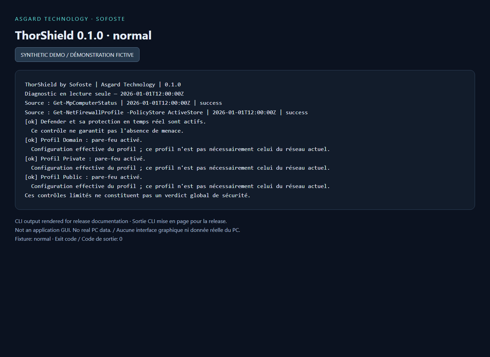
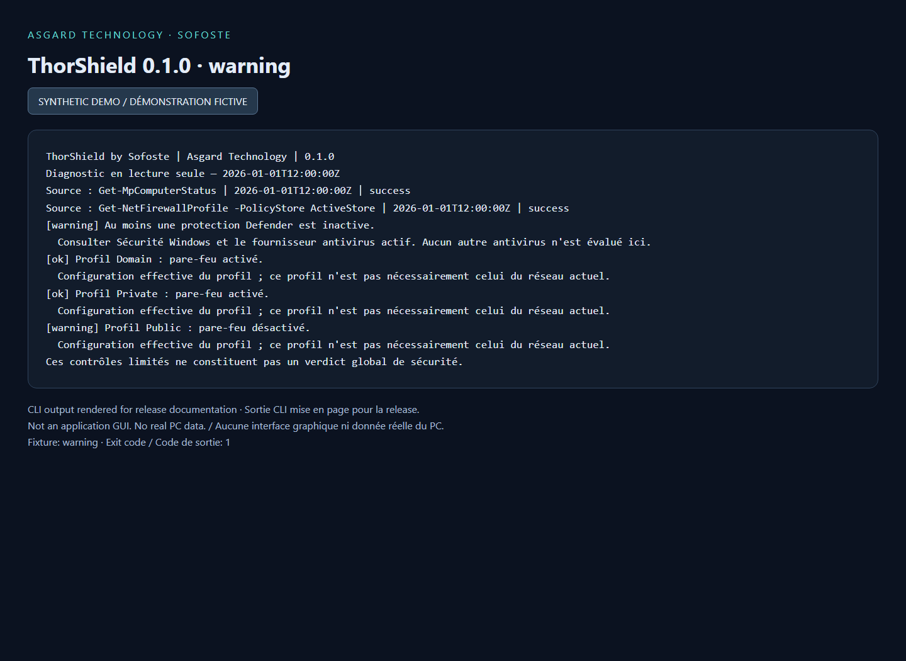
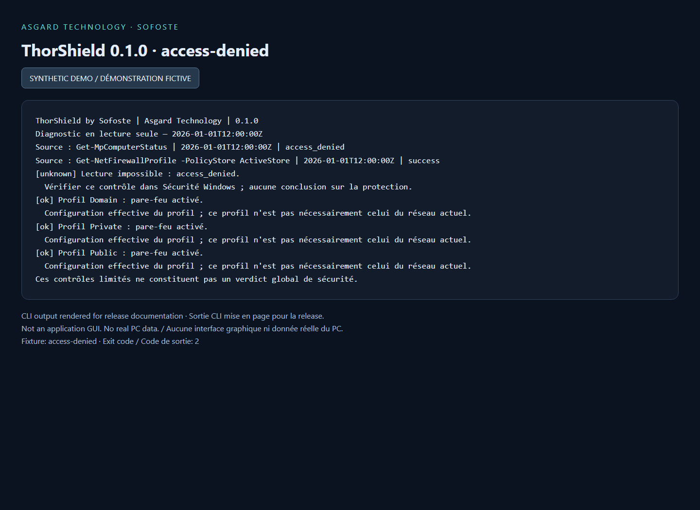

# ThorShield v0.1.0

## English

First experimental Java 21 release: read-only Windows Defender and firewall diagnostics, French CLI messages, optional JSON export, explicit unknown states, and 24 automated tests. Python and Rust are planned, not implemented.

The images below render actual report output from synthetic fixtures with a fixed demonstration timestamp. They are documentation previews, not a graphical application or evidence about a real PC.

Download `thorshield.jar`, verify its SHA-256 against `SHA256SUMS.txt`, then run `java -jar thorshield.jar --help` with Java 21+. The checksum checks consistency with the release asset; it is not a publisher signature. This experimental package is unsigned and is not an antivirus.

## Français

Première version expérimentale Java 21 : diagnostic Windows Defender et pare-feu en lecture seule, messages CLI français, export JSON facultatif, états inconnus explicites et 24 tests automatisés. Python et Rust sont prévus, pas encore implémentés.

Les images ci-dessous présentent la sortie réelle du formateur de rapports sur des scénarios fictifs, avec une date de démonstration fixe. Ce sont des aperçus documentaires, pas une interface graphique ni une preuve concernant un vrai PC.

Télécharger `thorshield.jar`, vérifier son SHA-256 avec `SHA256SUMS.txt`, puis lancer `java -jar thorshield.jar --help` avec Java 21 ou plus récent. L'empreinte vérifie la cohérence avec le fichier de la release ; ce n'est pas une signature de l'éditeur. Ce paquet expérimental n'est pas signé et ne constitue pas un antivirus.

## Previews / Aperçus

### Normal / État normal

### Warning / Avertissement

### Access denied / Accès refusé

