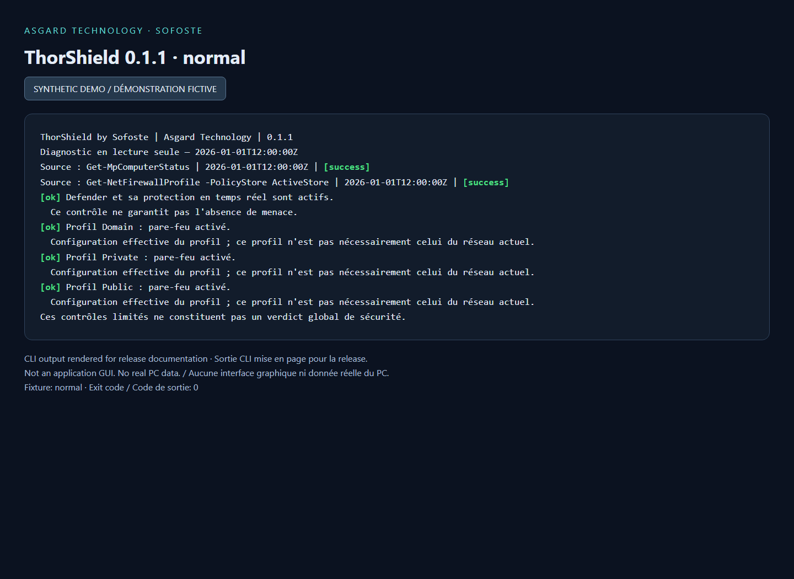
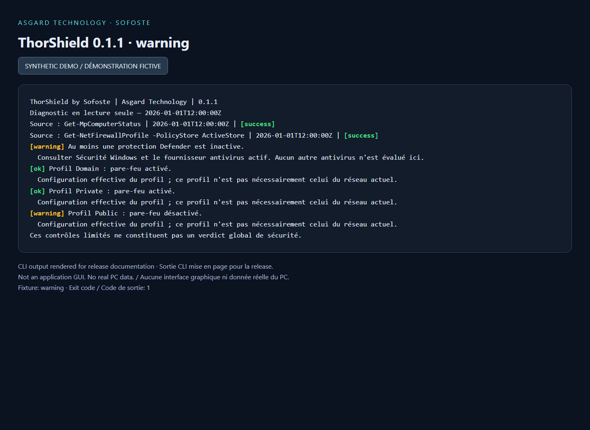
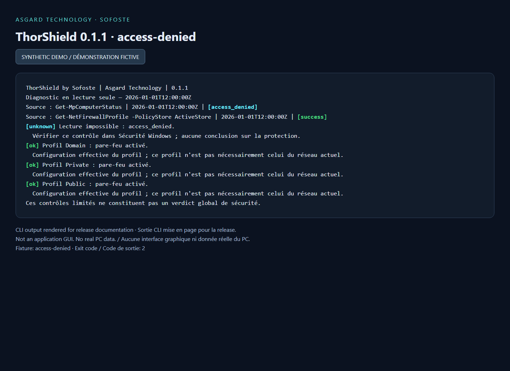

# ThorShield v0.1.1 — State colors / Couleurs des états

## English

The Java CLI now gives each state a distinct color while keeping its label visible:

| State | Color | Meaning |
| --- | --- | --- |
| `ok` | Green | The checked indicator is active |
| `warning` | Yellow / amber | An item needs review |
| `unknown` | Cyan | Insufficient or unavailable information |
| `error` | Red | CLI or export failure; not a malware verdict |

Use `--color auto|always|never`. Automatic mode requires a recognized interactive terminal, respects a nonempty `NO_COLOR`, and stays plain when redirected. `always` explicitly overrides these checks. Terminal themes control the exact shades. JSON and exit-code semantics are unchanged. **35 tests pass.**

Java 21+ is required. Download the JAR and check it against `SHA256SUMS.txt`, then run `java -jar thorshield.jar --color always`. Checksums verify file consistency, not publisher identity. This remains an unsigned experimental diagnostic tool, not an antivirus. CLI messages are in French; documentation is bilingual.

## Français

La CLI Java associe désormais une couleur à chaque état tout en conservant son libellé :

| État | Couleur | Signification |
| --- | --- | --- |
| `ok` | Vert | L'indicateur vérifié est actif |
| `warning` | Jaune / orange | Un point mérite vérification |
| `unknown` | Cyan | Information insuffisante ou inaccessible |
| `error` | Rouge | Erreur CLI ou export ; pas un verdict de logiciel malveillant |

Utiliser `--color auto|always|never`. Le mode automatique exige un terminal interactif reconnu, respecte une variable `NO_COLOR` non vide et laisse les sorties redirigées sans couleur. `always` force explicitement les couleurs. Les teintes exactes dépendent du thème du terminal. Le JSON et la signification des codes de sortie restent identiques. **35 tests réussissent.**

Java 21 ou plus récent est nécessaire. Télécharger le JAR et vérifier son empreinte avec `SHA256SUMS.txt`, puis lancer `java -jar thorshield.jar --color always`. Les empreintes vérifient la cohérence des fichiers, pas l'identité de l'éditeur. L'outil reste un diagnostic expérimental non signé, pas un antivirus. La CLI est en français et la documentation bilingue.

## Synthetic previews / Aperçus fictifs

Actual report formatting rendered from synthetic fixtures, with a fixed demonstration date. No real PC information; these are documentation images, not an application GUI.

Sortie du formateur réel de rapports, rendue à partir de scénarios fictifs et d'une date de démonstration fixe. Aucune information réelle du PC ; il s'agit d'images documentaires, pas d'une interface graphique.

